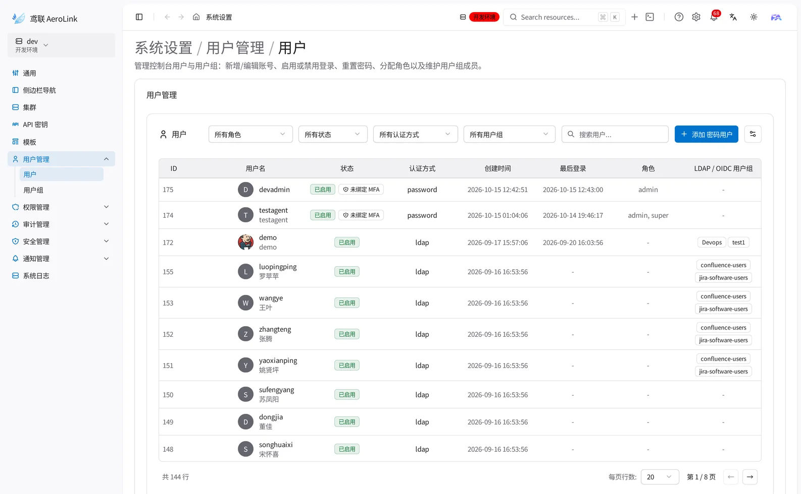
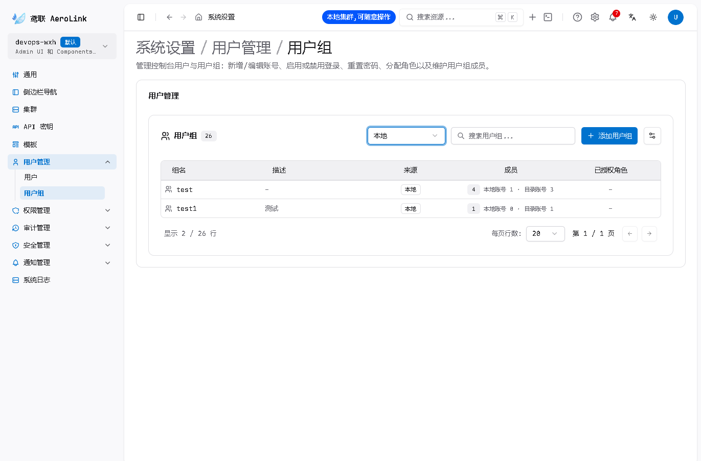

# 用户管理

鸢联 AeroLink 支持多种用户管理方式，结合 OAuth 与本地密码用户，配合 RBAC 权限系统，实现灵活的访问控制。

## 用户类型

- **OAuth 用户**：通过第三方身份提供商（如 GitHub、OIDC 等）登录。

如何配置 OAuth 见 [OAuth 配置指南](./oauth-setup.md)

- **密码用户**： 通过用户名和密码登录。密码用户可以启用认证器应用 MFA。
- **API 密钥**：用于脚本、CI/CD 或外部系统调用鸢联 AeroLink API。参见 [API 认证](../api/authentication.md)。

## 用户管理

拥有 **admin** 角色的用户，可在页面右上角进入设置入口，进入用户与权限管理界面。

在该界面，您可以：

- 查看当前所有用户及其角色信息
- 新增用户（仅支持密码用户）
- 禁用或删除不再需要的账号
- 修改用户的角色分配，实现权限调整

## 用户组

「用户管理 → 用户组」把本地账号与目录账号按组管理，再通过权限绑定整组授权，不必逐个账号配置。列表可按来源（本地 / 目录）筛选，并显示每个组的成员数与已授权角色。

## 账号安全

MFA 默认**不强制绑定**（`mfaPolicy: disabled`）。管理员可在 **设置 → 安全管理 → 认证安全 → MFA** 里选择「所有人 / 仅管理员」强制绑定；已经绑定了 MFA 的账号，登录时一律验码，与这里的选项无关。

本地密码与 LDAP 账号都可以绑定 TOTP 认证器（账号设置弹窗里操作）；OAuth / OIDC 账号由身份提供商侧负责，平台不额外要求 MFA。

## 最佳实践

- 推荐优先使用 OAuth 用户，实现统一身份管理
- 密码用户适用于特殊或临时场景
- 为密码用户启用 MFA
- 定期审查用户列表和角色分配，确保权限最小化
- 禁用未使用账号，降低安全风险

权限分配可参考 [RBAC 权限管理](./rbac-config.md)
