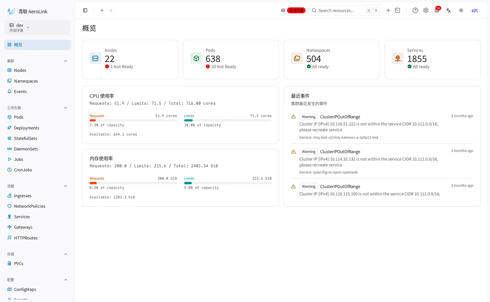

# What is AeroLink?

AeroLink is a lightweight, open-source Kubernetes workspace for platform teams. It brings multi-cluster operations, observability, access control, and AI-assisted troubleshooting into one interface.

## Name and pronunciation

- **Name**: 鸢联 in Chinese, **AeroLink** in English, pronounced /ˈeəroʊlɪŋk/ (Aero = sky, Link = connection).
- **One-line pitch**: Flying above K8s, connecting every cluster.
- **Prefixes**: environment variables use `AEROLINK_` (e.g. `AEROLINK_ENCRYPT_KEY`), Kubernetes annotations use `aerolink.io/` (e.g. `aerolink.io/description`). Candidate public domains are `aerolink.io` / `aerolink.dev` / `aerolink.cloud`; the internal deployment domain is `aerolink.gogdev.cn`.
- **CLI and package name**: `aero` / `alink` and `io.aerolink` are naming plans only, not implemented; the only binary today is the `aerolink` server.
- **Statement**: this project is a fork of [Kite](https://github.com/kite-org/kite), not an official Kite release.

## Start here

::: tip Fastest evaluation path
Install AeroLink with Helm, use port forwarding for the first visit, then connect the in-cluster Kubernetes API. You can complete the initial setup without preparing a kubeconfig.
:::

1. [Install AeroLink](./installation) and open the dashboard.
2. [Set up users](/en/config/user-management) and [RBAC](/en/config/rbac-config) before inviting your team.
3. [Connect Prometheus](/en/config/prometheus-setup) when you are ready to add cluster metrics.

## Find the right guide

- **Find any resource quickly:** [Global Search](./global-search)
- **Understand a workload and its dependencies:** [Related Resources](./related-resources)
- **Investigate a running Pod:** [Logs](./logs) and [Web Terminal](./web-terminal)
- **Track cluster health and usage:** [Monitoring](./monitoring)
- **Install and manage releases:** [Helm Management](./helm-management)
- **Review resource changes:** [Resource History](./resource-history)
- **Read the audit trail and compliance notes:** [Audit & Compliance](./audit-and-compliance)
- **Configure in-app messages, email and announcements:** [Notifications & Announcements](./notification-and-announcements)
- **Troubleshoot with an AI agent:** [AI Assistant](./ai-assistant)
- **Connect private or remote clusters:** [AeroLink Cluster Agent](./aerolink-cluster-agent)
- **Package and push your own image:** [Build and Push Image](./build-and-push-image)
- **Deployment shapes and operations (upgrade, rollback, backup, database switch):** [Deployment and Operations](./operations)

## Platform at a glance

### Observe

Use real-time CPU, memory, and network charts, live Pod logs, events, and resource relationships to move from a symptom to its context.

### Operate

Create and edit Kubernetes resources, manage Helm releases, open Pod and Node terminals, run kubectl, and access workloads through Kube Proxy.

### Govern

Manage team access with OAuth, MFA, users, RBAC, role mappings, and audit logs across multiple clusters.

## Where AeroLink fits

Headlamp and Kubernetes Dashboard are strong tools for inspecting and operating individual clusters. AeroLink adds a shared workspace for multi-cluster operations, built-in team governance, observability, and AI-assisted workflows.

If you are evaluating AeroLink, continue with the [installation guide](./installation).
