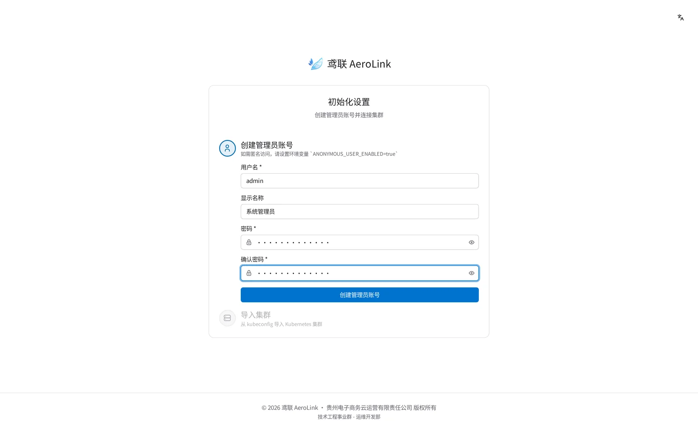
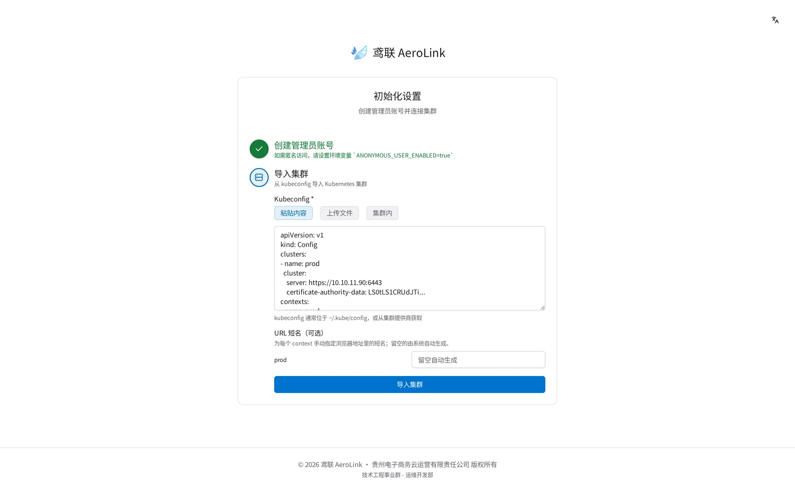

# Installation Guide

This guide provides detailed instructions for installing AeroLink in a Kubernetes environment.

## Prerequisites

- `kubectl` with cluster administrator privileges
- Helm v3.8+ (or v4)
- MySQL/PostgreSQL database, or local storage for sqlite

## Installation Methods

### Method 1: Helm Chart (Recommended)

Using Helm provides flexibility for configuration and upgrades. The in-repo chart already points its default image at the company SWR, so a plain install is enough:

```bash
helm install aerolink charts/aerolink -n aerolink-system --create-namespace
```

#### Custom Installation

You can adjust installation parameters by customizing the values file:

For complete configuration, refer to [Chart Values](../config/chart-values).

Install with custom values:

```bash
helm install aerolink charts/aerolink -n aerolink-system -f values.yaml
```

### Method 2: YAML Manifest

For quick deployment, you can directly apply the installation YAML from the repository:

::: warning
This method is not suitable for production environments, as it does not include any configuration related to persistence. You need to manually mount the persistence volume and set the environment variable `DB_DSN=/data/db.sqlite` to ensure that data is not lost. Alternatively, you can use an external database.

see [Persistence Issues](../faq#persistence-issues) for more details.
:::

```bash
kubectl apply -f deploy/install.yaml
```

This method will install AeroLink with default configuration. For advanced customization, it's recommended to use the Helm Chart.

## Accessing AeroLink

### Port Forwarding (Testing Environment)

During testing, you can quickly access AeroLink through port forwarding:

```bash
kubectl port-forward -n aerolink-system svc/aerolink 8080:8080
```

### LoadBalancer Service

If the cluster supports LoadBalancer, you can directly expose the AeroLink service:

```bash
kubectl patch svc aerolink -n aerolink-system -p '{"spec": {"type": "LoadBalancer"}}'
```

Get the assigned IP:

```bash
kubectl get svc aerolink -n aerolink-system
```

### Ingress (Recommended for Production)

For production environments, it's recommended to expose AeroLink through an Ingress controller with TLS enabled:

::: warning
AeroLink's log and web terminal features require websocket support.
Some Ingress controllers may require additional configuration to handle websockets correctly.
:::

```yaml
apiVersion: networking.k8s.io/v1
kind: Ingress
metadata:
  name: aerolink
  namespace: aerolink-system
spec:
  ingressClassName: nginx
  rules:
    - host: aerolink.example.com
      http:
        paths:
          - path: /
            pathType: Prefix
            backend:
              service:
                name: aerolink
                port:
                  number: 8080
  tls:
    - hosts:
        - aerolink.example.com
      secretName: aerolink-tls
```

## Serving under a subpath (basePath)

If you want to serve AeroLink under a subpath (for example `https://example.com/aerolink`), use the Helm chart `basePath` value.

How to set it:

- In `values.yaml`:

```yaml
basePath: "/aerolink"
```

- Or with Helm CLI:

```bash
helm install aerolink charts/aerolink -n aerolink-system --create-namespace --set basePath="/aerolink"
```

Important notes:

- Ingress configuration: make sure your Ingress `paths` match the subpath and use a matching pathType (e.g., `Prefix`). Example:

```yaml
ingress:
  enabled: true
  hosts:
    - host: aerolink.example.com
      paths:
        - path: /aerolink
          pathType: Prefix
```

- OAuth / redirects: if you enable OAuth (or any external redirect flows), update the redirect URLs in your OAuth provider to include the base path, e.g. `https://aerolink.example.com/aerolink/oauth/callback`.
- Environment overrides: if you provide environment variables via `extraEnvs` or an existing secret, ensure `AEROLINK_BASE` is set consistently with the `basePath` value (otherwise behavior may differ).

## Verifying Installation

After installation, you can access the dashboard to verify that AeroLink is deployed successfully. The expected interface is as follows:

::: tip
If you need to configure AeroLink through environment variables, please refer to [Environment Variables](../config/env).
:::





You can complete cluster setup according to the page prompts.

### Quick Setup with In-Cluster Mode

For the simplest setup, select **`in-cluster`** as the cluster type. This option automatically uses the service account credentials that AeroLink is running with inside the cluster, requiring no additional configuration:

- **No kubeconfig needed**: AeroLink will use its own service account to access the Kubernetes API
- **Automatic authentication**: Works out of the box with the default RBAC permissions
- **Ideal for single-cluster deployments**: Perfect when AeroLink is managing the same cluster it's running in

This is the recommended option for getting started quickly, especially in development or when AeroLink only needs to manage its own cluster.

## Upgrading

**v1.0.6** has no schema changes and no startup backfills: replace the image or run `helm upgrade`; no manual SQL is required.

The DDL / DML lists below cover earlier releases (including v1.0.5). When upgrading across several versions, still follow the notes for those versions.

For a Helm install, use `helm upgrade` (`--reuse-values` keeps the existing configuration):

```bash
helm upgrade aerolink charts/aerolink -n aerolink-system --reuse-values
```

For a YAML manifest install, re-apply the new manifest:

```bash
kubectl apply -f deploy/install.yaml
```

### Schema changes that need to be run manually

Some releases add database columns. The application account is usually **not the table owner**, so
`AutoMigrate` cannot add the column in a production database (PostgreSQL reports
`must be owner of table ...`). Run the SQL below with an account that has DDL privileges before
upgrading, otherwise the features that depend on the new column will fail.

**Help documentation entry** (`general_settings.help_url`) — run before upgrading:

```sql
-- PostgreSQL
ALTER TABLE general_settings ADD COLUMN IF NOT EXISTS help_url varchar(500);

-- MySQL 5.7 / 8.x: no IF NOT EXISTS; error 1060 Duplicate column name means the column already exists, ignore it
ALTER TABLE general_settings ADD COLUMN help_url varchar(500);

-- SQLite: the app owns the local file and adds the column on startup, usually nothing to do here
ALTER TABLE general_settings ADD COLUMN help_url varchar(500);
```

Skipping it has limited impact: reading and writing the help URL fails (saving general settings
returns 500), everything else works.

**Cluster badge font size, bold and icon text color** (`clusters.badge_text_size` / `badge_bold` /
`badge_icon_text_size` / `badge_icon_text_color` / `badge_icon_bold`) — run before upgrading:

```sql
-- PostgreSQL
ALTER TABLE clusters ADD COLUMN IF NOT EXISTS badge_text_size varchar(8);
ALTER TABLE clusters ADD COLUMN IF NOT EXISTS badge_bold boolean NOT NULL DEFAULT false;
ALTER TABLE clusters ADD COLUMN IF NOT EXISTS badge_text_color varchar(16);
ALTER TABLE clusters ADD COLUMN IF NOT EXISTS badge_icon_text_size varchar(8);
ALTER TABLE clusters ADD COLUMN IF NOT EXISTS badge_icon_text_color varchar(16);
ALTER TABLE clusters ADD COLUMN IF NOT EXISTS badge_icon_text_background varchar(16);
ALTER TABLE clusters ADD COLUMN IF NOT EXISTS badge_icon_bold boolean NOT NULL DEFAULT false;

-- MySQL 5.7 / 8.x: no IF NOT EXISTS; error 1060 Duplicate column name means the column already exists, ignore it
ALTER TABLE clusters ADD COLUMN badge_text_size VARCHAR(8) NULL;
ALTER TABLE clusters ADD COLUMN badge_bold TINYINT(1) NOT NULL DEFAULT 0;
ALTER TABLE clusters ADD COLUMN badge_text_color VARCHAR(16) NULL;
ALTER TABLE clusters ADD COLUMN badge_icon_text_size VARCHAR(8) NULL;
ALTER TABLE clusters ADD COLUMN badge_icon_text_color VARCHAR(16) NULL;
ALTER TABLE clusters ADD COLUMN badge_icon_text_background VARCHAR(16) NULL;
ALTER TABLE clusters ADD COLUMN badge_icon_bold TINYINT(1) NOT NULL DEFAULT 0;

-- SQLite: the app owns the local file and adds the columns on startup, usually nothing to do here
ALTER TABLE clusters ADD COLUMN badge_text_size varchar(8);
ALTER TABLE clusters ADD COLUMN badge_bold numeric NOT NULL DEFAULT false;
ALTER TABLE clusters ADD COLUMN badge_text_color varchar(16);
ALTER TABLE clusters ADD COLUMN badge_icon_text_size varchar(8);
ALTER TABLE clusters ADD COLUMN badge_icon_text_color varchar(16);
ALTER TABLE clusters ADD COLUMN badge_icon_text_background varchar(16);
ALTER TABLE clusters ADD COLUMN badge_icon_bold numeric NOT NULL DEFAULT false;
```

Skipping this one hurts more: **creating / importing clusters and saving badge settings fail**
(the write statements include the new columns, so they report a missing column). Reading and
rendering existing clusters still works, falling back to the default typography.

After upgrading, check the logs: `库结构与模型一致` (`schema matches the models`) means it is fine;
`库表 general_settings 缺少列 help_url` or `库表 clusters 缺少列 badge_text_size` means the SQL was
not run or the pod was not restarted. Note that with `AEROLINK_LOG_FILE` set, `Info` level lines
only go to that file and not to the container's stdout — `kubectl logs` then only shows errors.

### Data backfills (DML only, no table owner needed)

v1.0.5 adds no columns or indexes (no DDL), but it runs two **startup data backfills**. The
application account only needs `UPDATE` privileges:

- **Legacy brand names**: rewrites `[Kite] …` subjects/bodies in `notification_templates` and the
  old default `otpIssuerName` in `security_settings` to "鸢联 AeroLink". Only the brand word is
  replaced — wording customized by an administrator is kept as-is, and notifications already sent
  are not rewritten.
- **Single enabled announcement**: if several announcements are enabled, only the highest-priority
  one stays enabled on startup.

With `DB_MIGRATE=off` (or when a DBA prefers to run it manually), use the equivalent SQL below
(idempotent; MySQL / SQLite `LIKE` is case-insensitive for ASCII while `REPLACE` is case-sensitive,
so nothing is over-replaced):

```sql
-- Brand rename: notification templates and OTP issuer (same on all three databases)
UPDATE notification_templates
   SET subject = REPLACE(subject, '[Kite] ', '[鸢联] '),
       body    = REPLACE(body, 'Kite', '鸢联')
 WHERE subject LIKE '%Kite%' OR body LIKE '%Kite%';

UPDATE security_settings
   SET data = REPLACE(data, '"otpIssuerName":"Kite"', '"otpIssuerName":"鸢联 AeroLink"')
 WHERE data LIKE '%"otpIssuerName":"Kite"%';

-- Keep a single enabled announcement (MySQL requires the derived table wrapper)
UPDATE announcements SET enabled = false
 WHERE enabled = true
   AND id <> (SELECT keep_id FROM (SELECT id AS keep_id FROM announcements
                                   WHERE enabled = true ORDER BY priority DESC, id DESC LIMIT 1) t);
```

After upgrading, check the startup log for `品牌改名回填：更新通知模板 N 条`; template subjects under
**Settings → Notification Management → Templates** should all start with `[鸢联]`, and at most one
announcement should be enabled.

## Uninstalling AeroLink

### Helm Uninstall

```bash
helm uninstall aerolink -n aerolink-system
```

### YAML Uninstall

```bash
kubectl delete -f deploy/install.yaml
```

## Next Steps

After AeroLink installation is complete, you can continue with:

- [Adding Users](../config/user-management)
- [Configuring RBAC](../config/rbac-config)
- [Configuring OAuth Authentication](../config/oauth-setup)
- [Setting up Prometheus Monitoring](../config/prometheus-setup)
- [Deployment and Operations (shapes, systemd, upgrade and rollback, backup and database switch)](./operations)
