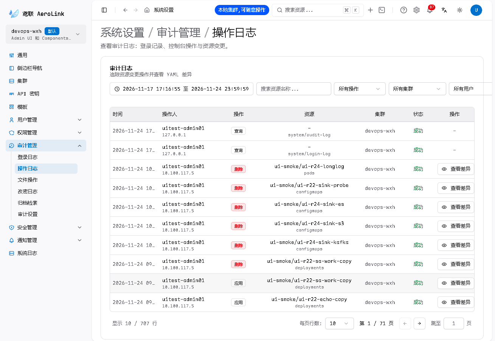

# 审计与合规

鸢联 AeroLink 的审计记录**只写不改**：没有任何接口可以修改或删除一条已经落地的审计记录（清理只按保留策略整批过期），导出文件带服务端签名，可用于事后核对。本页说明查什么、在哪查、存多久、怎么外发。

## 在哪里查

「系统设置 → 审计管理」下有六个页签：

| 页签 | 内容 | 数据来源 |
| --- | --- | --- |
| 登录日志 | 每次登录尝试（含成功与失败） | `login_records` 表 |
| 操作日志 | 管理面操作与资源变更 | `resource_histories` 表 |
| 文件操作 | Pod 文件页的查看、下载、上传 | `resource_histories` 中的文件类操作 |
| 改密日志 | 密码修改记录 | `password_change_logs` 表 |
| 归档检索 | 已经归档出去的历史日志（本地已过期的也能查到） | 见[归档与检索](#归档与检索) |
| 审计设置 | 保留策略、归档、外发 | `audit_settings` 表 |

另有两条独立入口：

- **系统日志**：「系统设置 → 系统日志」，访问日志（HTTP 访问记录）的归档与输出格式。访问日志量级比审计日志大得多，所以与审计日志分开配置、默认保留期更短。
- **资源历史**：单个资源的变更历史，在资源详情页的「历史」页签里，见[资源历史](./resource-history.md)。

## 各类记录记了什么

### 登录日志

每条记录包含时间、用户名、登录方式（本地密码 / LDAP / OAuth / API Key）、客户端 IP、User-Agent 与结果。**结果为空表示登录成功**，非空是失败原因码，界面会翻译成中文，例如：

| 结果码 | 含义 |
| --- | --- |
| `invalid_credentials` | 用户名或密码错误 |
| `mfa_invalid` | 动态码错误 |
| `captcha_invalid` | 验证码错误 |
| `ip_denied` | 来源 IP 被拒绝 |
| `source_denied` | 来源地址不在允许列表内 |
| `too_many_attempts` | 尝试次数过多，账号或 IP 已被锁定 |
| `not_provisioned` | 目录用户尚未在控制台开通 |
| `no_permission` | 账号被禁用，或没有任何权限 |
| `account_expired` | 账号已过期 |

### 操作日志

每条记录包含操作者、时间、集群、资源类型 / 名称 / 命名空间、操作类型、来源（手工 / 定时任务 / AI 工具）、成功与否与失败原因、客户端 IP 与 User-Agent，以及变更前后的 YAML。

两个值得注意的口径：

- 记录里的**操作者用户名是写入时的快照**。账号后来被删除或改名，历史记录仍然能追溯到具体的人——外键在账号删除时置空，而不是级联删除记录。
- 不经 HTTP 的写入（定时任务、AI 工具）没有客户端 IP 与 User-Agent，这两列为空。

### 文件操作

从操作日志里筛出的三类动作：查看文件（`view-file`）、下载文件（`download-file`）、上传文件（`upload-file`），包含容器与文件路径。用来回答「这份日志是谁下载走的」。

### 改密日志

密码修改的时间与操作者。与密码策略里的「不能重复前几次密码」配合使用，见[安全策略](../config/security-policy.md)。

## 导出与核对

各列表页都可以导出 CSV。下载响应的头里带两个指纹：

| 响应头 | 含义 |
| --- | --- |
| `X-Audit-Content-SHA256` | 文件内容的 SHA-256（十六进制） |
| `X-Audit-Content-HMAC` | 服务端密钥对文件内容计算的 HMAC-SHA256 |

核对方法是：对拿到的文件执行 `sha256sum`，结果应与界面给出的 SHA-256 一致；HMAC 证明这份导出确实由本服务器生成——只比对 SHA-256 的话，任何文件都能配上一个自洽的哈希。

## 存储方式（五选一）

审计记录的落地方式**在启动时决定**，界面上只读：写配置文件的 `auditSink` 或环境变量 `AEROLINK_AUDIT_SINK`，取值 `database`（默认）、`parquet`、`elasticsearch`、`victorialogs`、`openobserve`，五者互斥。取值非法、或所选通道的前置条件没配好（如 `parquet` 没有归档目录、`elasticsearch` 没有节点地址），服务会**拒绝启动**而不是静默回落。

`database` 是唯一例外：它始终落库（资源变更历史、平台操作时间等能力都可用），此外还可以在「审计设置 → 归档」里额外开启「归档 + S3」作为**冷归档副本**——把记录异步再落一份 parquet 到对象存储（如 COS，开对象锁定可长期不可变留存），满足等保三级「留存 ≥ 6 个月 + 防篡改」。冷归档强制带上变更前后的资源 YAML，且开启后归档检索（DuckDB）可用。

多副本部署时每一份副本都要配同一个值，否则记录会散到不同存储里。完整取值与前置条件见[环境变量](../config/env.md)与[配置文件](../config/config-file.md)。

## 归档与检索

归档是**尽力而为**的：写入失败不影响本地落库，也不拖慢请求。

- **本地 parquet**：按「攒批间隔 / 单批条数 / 单批字节数」三个阈值中任意一个触发落文件，可在「审计设置 → 归档」里调；默认**不写入变更前后的资源 YAML**（会让文件变大），需要溯源时再打开。
- **S3 远端副本**：可选。用于把归档复制到对象存储；本地文件在确认上传后可删除。
- **DuckDB（直接查 parquet）**：无需额外部署组件，检索时直接读 parquet 文件。查 S3 上的归档依赖 `httpfs` 扩展，见[环境变量](../config/env.md)里的 `AEROLINK_DUCKDB_EXTENSION_DIR`。
- **Elasticsearch / VictoriaLogs / OpenObserve**：由各自的服务端承担存储与过期。查不到数据时先核对流名：OpenObserve 会把流名里的 `-` 换成 `_`（默认的 `aerolink-audit` 实际落在 `aerolink_audit`）；VictoriaLogs 按配置的 `stream` 字段分流，不是按索引名。

「审计管理 → 归档检索」页可以按后端切换检索（数据来源跟随当前存储方式），检索三类记录：操作历史、登录日志、访问日志。两点注意：

- **归档写入是异步的**：刚发生的操作可能还没落进检索索引，页面上会给出当前 sink 的查询延迟上限。
- 当存储方式是 `database`（默认）且未开启冷归档时没有归档可查，检索页会提示先在「审计设置 → 归档」开启冷归档。

## 保留策略

| 范围 | 默认 | 说明 |
| --- | --- | --- |
| 审计日志（数据库） | 永久保留 | 可设置保留天数，下限 30 天；`0` 表示永久 |
| 归档文件（本地 parquet / S3） | 7 天 | `0` 表示不按时间清理；也可设容量上限，超出时先删最旧的文件 |
| 访问日志（归档） | 3 天 | 与审计日志分开配置 |
| Elasticsearch | 按天索引 | 过期索引整批删除 |
| VictoriaLogs / OpenObserve | 由服务端负责 | 「审计设置」里的保留天数对它们不生效：分别是 VictoriaLogs 的 `-retentionPeriod` 与 OpenObserve 的 stream `data_retention` |

清理是后台定时任务：数据库审计记录每 24 小时一轮（启动 2 分钟后首跑，每轮分批删除）；本地归档文件每 6 小时一轮。

## 外发

除落库外，审计事件还可以送到日志平台：

| 方式 | 说明 |
| --- | --- |
| 标准输出 | **默认开启**、JSON 单行；交给 Filebeat / Fluent Bit 等采集工具收走。只输出操作 / 登录 / 改密三类（访问日志已由访问日志中间件输出，再投一份就是重复） |
| syslog | `udp` / `tcp` / `tls`，默认 APP-NAME 为 `aerolink`、facility 为 `13`（log audit）；正文格式可选 key=value 或 JSON，自签证书场景可跳过服务端证书校验 |
| Kafka | 支持 SASL 与 TLS |

外发是「一个开关 + 一种方式」（syslog 或 Kafka 二选一），在「审计管理 → 审计设置」里配置；口令类字段不会回显。

## 合规要点

- **审计记录只读**：只能查看，界面与接口都不提供删除入口。
- **可追溯到人**：每条记录都带操作者、时间与来源（IP / User-Agent），且操作者用户名是快照，不受账号后续变更影响。
- **导出可验证**：导出文件带 SHA-256 与 HMAC-SHA256 双指纹。
- **职责分离**：审计管理员只能查看审计，不能修改配置；三权分立的互斥与硬拒绝见[安全策略](../config/security-policy.md)。

## 限制与注意

- **资源级变更历史需要 `database` sink**：`parquet` 默认不写资源 YAML，Elasticsearch 的文档也不含 YAML，两者都撑不起「变更前后对比」。
- **多副本下 parquet 必须是共享卷**：每份副本只写自己产生的记录，检索读的又是本地目录；目录不共享就查不全。
- **不单独审计 Secret 读取**：Secret 作为普通资源纳入操作日志（写操作有记录），没有「谁查看了这个 Secret」的独立记录。