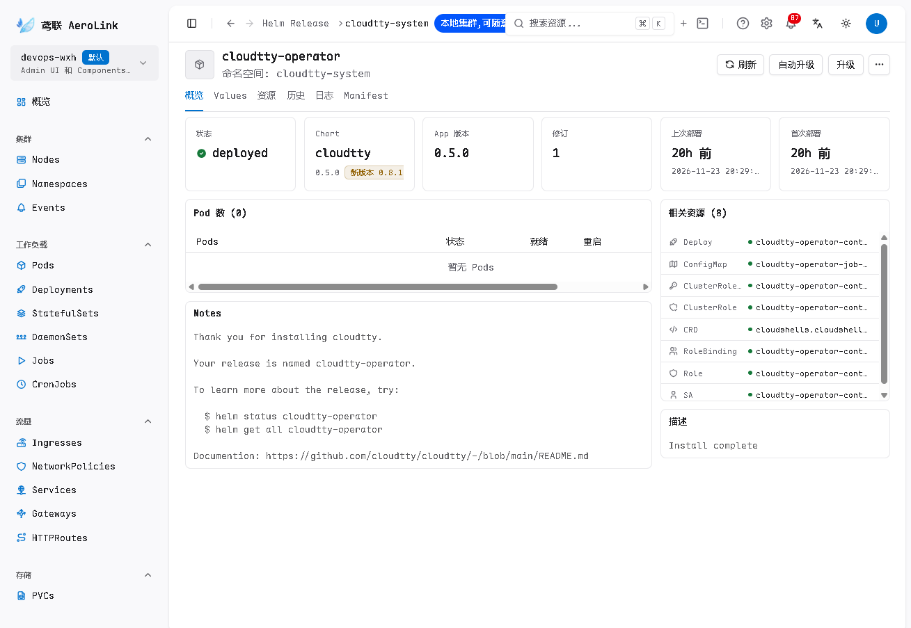

# Helm 管理

鸢联 AeroLink 在 Dashboard 中提供基础 Helm 管理能力，包括 Chart 发现、Release 安装、升级、回滚和卸载。

## App Catalog

从侧边栏打开 **App Catalog** 可以浏览 Helm Charts。

| 编号 | 位置 | 说明 |
| --- | --- | --- |
| ① | 顶部左侧 | Artifact Hub（公开源）/ Repository（自己配置的仓库） |
| ② | 顶部右侧 | 按 Chart 名称搜索 |
| ③ | 表格 | 点 Chart 名进详情，看 README、values、versions |

鸢联 AeroLink 支持两类 Chart 来源：

- **Artifact Hub**：搜索公开 Helm Charts。
- **Repositories**：浏览在鸢联 AeroLink 中托管的 Helm Repositories。

::: tip
使用 Artifact Hub 来源时，鸢联 AeroLink 可能会请求 Artifact Hub 来获取 Chart 列表和详情。
:::

::: warning
鸢联 AeroLink 只是展示 Chart 信息，不对其中的内容负责。安装或升级前，请仔细审查 Chart 详情、templates 和 values。
:::

拥有 **admin** 角色的用户可以添加或删除 Helm Repository。支持传统仓库（`https://`）和 OCI 仓库（`oci://`）；OCI URL 需指向单个 Chart 路径，且不能带 tag 或 digest（例如 `oci://registry.example.com/charts/app`），其 semver 格式的 registry tag 会作为该 Chart 的版本列表。删除 Repository 只会从鸢联 AeroLink 移除这个来源，不会卸载已有 Release。

进入 Chart 详情后，可以查看 README、values、templates 和版本。如果 Chart package 可用，可以直接从鸢联 AeroLink 安装。

### 安装一个 Chart

1. 打开 App Catalog，选来源并搜索 Chart（如 `nginx`）；
2. 点进 Chart 详情，选版本；
3. 选目标命名空间，按需修改 values；
4. 先点 dry-run 预览渲染出的资源清单；
5. 确认后安装，完成后到 **Helm Release** 看状态与 resources。

安装前先确认命名空间配额还有余量（见[命名空间配额](/usage/resources#命名空间配额)），否则渲染成功也可能因配额被拒。

## Helm Releases

从侧边栏打开 **Helm Release** 可以查看已安装的 Releases。

Release 详情页会展示状态、Chart 版本、values、资源、历史记录、日志和渲染后的 manifests。

安装和升级前支持 dry-run 预览。你可以在详情页升级 Release，在历史记录中回滚，也可以删除 Release 来从集群中卸载。

## 权限

Repository 管理需要 **admin** 角色。Release 操作通过鸢联 AeroLink RBAC 的 `helmrelease` 资源控制（`get`、`create`、`update`、`delete`）。

::: warning
请谨慎授予 `helmrelease` 权限。Helm 操作会使用鸢联 AeroLink 中配置的集群凭据执行，因此拥有 `helmrelease` 的 `create`、`update` 或 `delete` 权限的用户，可能可以创建、更新或删除 Chart 渲染出的资源，即使该用户自己的 Kubernetes RBAC 权限不允许直接执行这些操作。

鸢联 AeroLink 中配置的集群凭据也需要具备操作 Chart 渲染资源的 Kubernetes 权限。
:::
