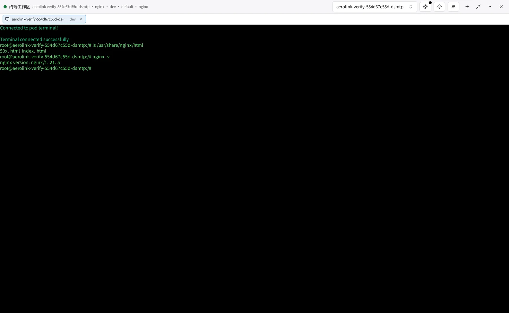

# Web 终端

鸢联 AeroLink 提供集成的 Web 终端：不用装 kubectl、不用配 kubeconfig，直接在浏览器里进入 Pod 或节点的命令行。

## 打开终端

| 目标 | 入口 |
| --- | --- |
| Pod | Pod 详情页 → 页头「终端」按钮 |
| 节点 | 节点详情页 → 页头「终端」按钮 |

终端在**页面底部的终端工作区**打开，不是弹窗：切页签、滚动页面都不会丢会话。

## 日常用法

- **多开**：再点一次「终端」会开新标签，多个会话并排使用；标签可关闭、可拖动。
- **容器选择**：多容器 Pod 进终端前先选容器，选错就进到别的容器里了。
- **没有 bash 时**：容器里没有 `bash` 会自动回落到 `sh`；也可以自己输入 `bash` / `sh`。
- **复制粘贴**：终端支持选中复制与右键/快捷键粘贴，取决于浏览器权限。
- **全屏**：工作区右上角可最大化，方便敲长命令。

## 超时与断线

- 会话**有超时**：长时间无操作或后端回收后终端会断开，重新点「终端」建新会话即可。
- 网络闪断、Ingress 超时会断开；表现为终端卡住或提示断开。终端走 WebSocket，反向代理必须放行 WebSocket 升级（见[安装指南](../guide/installation.md)）。
- 断线后的命令不会补执行，重要操作先确认提示符已恢复。

## 权限

| 操作 | 需要的权限 |
| --- | --- |
| 连 Pod | `pods/exec`，同时需要 `pods` 的 `get`（终端要先列出 Pod 与容器） |
| 连节点 | `nodes/exec` |

没有权限时终端按钮不显示，或点了建不起会话。授权方式见 [RBAC 配置](../config/rbac-config.md)。

::: warning 终端里的操作同样受审计
通过终端执行的命令不会逐条进审计，但会话本身和资源变更仍会记录；不要在终端里存放敏感信息。
:::