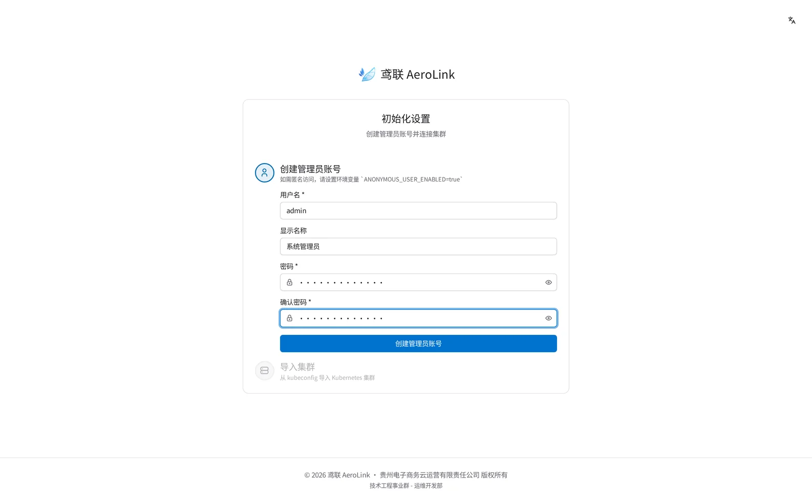
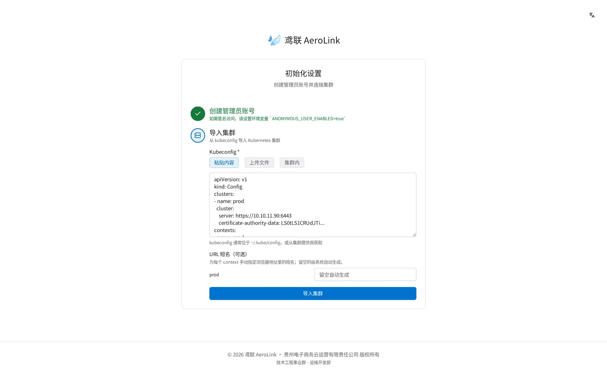

# 安装指南

本指南详细介绍如何在 Kubernetes 环境下安装鸢联 AeroLink。

## 前提条件

- 拥有集群管理员权限的 `kubectl`
- Helm v3.8+（或 v4）
- MySQL/PostgreSQL 数据库，或本地存储用于 sqlite

## 安装方式

### 方式一：Helm Chart（推荐）

使用 Helm 可灵活配置和升级鸢联 AeroLink。仓库内的 chart 默认镜像已指向公司 SWR，可直接安装：

```bash
helm install aerolink charts/aerolink -n aerolink-system --create-namespace
```

#### 自定义安装

可通过自定义 values 文件调整安装参数：

完整配置参考 [Chart Values](../config/chart-values.md)。

使用自定义值安装：

```bash
helm install aerolink charts/aerolink -n aerolink-system -f values.yaml
```

#### 使用自建镜像安装

如果你已经把源码打包成自己的镜像（见[构建并推送鸢联 AeroLink 镜像](./build-and-push-image.md)），用仓库内的 chart 安装并覆盖镜像地址：

```bash
helm install aerolink charts/aerolink -n aerolink-system --create-namespace \
  --set image.repository=<registry>/<namespace>/aerolink \
  --set image.tag=<版本>
```

私有仓库还需要配置拉取凭据（`--set imagePullSecrets[0].name=aerolink-regcred`）。

### 方式二：YAML 清单

如需快速部署，可直接应用仓库内的安装 YAML：

::: warning
此方法不适合生产环境，因为他没有配置任何持久化相关内容，你需要手动挂载持久化卷并设置环境变量 `DB_DSN=/data/db.sqlite` 来确保数据不会丢失。或者也可以使用外部数据库。

参考[支持哪些数据库，数据怎么持久化](../faq.md#支持哪些数据库-数据怎么持久化)获取更多详情。
:::

```bash
kubectl apply -f deploy/install.yaml
```

此方法将使用默认配置安装鸢联 AeroLink。如需高级定制，建议使用 Helm Chart。

## 访问鸢联 AeroLink

### 端口转发（测试环境）

测试期间可通过端口转发快速访问鸢联 AeroLink：

```bash
kubectl port-forward -n aerolink-system svc/aerolink 8080:8080
```

### LoadBalancer 服务

如集群支持 LoadBalancer，可直接暴露鸢联 AeroLink 服务：

```bash
kubectl patch svc aerolink -n aerolink-system -p '{"spec": {"type": "LoadBalancer"}}'
```

获取分配的 IP：

```bash
kubectl get svc aerolink -n aerolink-system
```

### Ingress（生产环境推荐）

生产环境建议通过 Ingress 控制器并启用 TLS 暴露鸢联 AeroLink：

::: warning
鸢联 AeroLink 的日志和 Web 终端功能需支持 websocket。
部分 Ingress 控制器可能需额外配置以正确处理 websocket。
:::

```yaml
apiVersion: networking.k8s.io/v1
kind: Ingress
metadata:
  name: aerolink
  namespace: aerolink-system
spec:
  ingressClassName: nginx
  rules:
    - host: aerolink.example.com
      http:
        paths:
          - path: /
            pathType: Prefix
            backend:
              service:
                name: aerolink
                port:
                  number: 8080
  tls:
    - hosts:
        - aerolink.example.com
      secretName: aerolink-tls
```

## 在子路径下部署（basePath）

如果您希望将鸢联 AeroLink 部署在一个子路径下，例如 `https://example.com/aerolink`，可以使用 Helm Chart 的 `basePath` 值来配置。

如何设置：

- 在 `values.yaml` 中：

```yaml
basePath: "/aerolink"
```

- 或使用 Helm CLI：

```bash
helm install aerolink charts/aerolink -n aerolink-system --create-namespace --set basePath="/aerolink"
```

说明：

- Ingress 配置：确保 Ingress 的 `paths` 与子路径一致，并使用合适的 `pathType`（例如 `Prefix`）。示例：

```yaml
ingress:
  enabled: true
  hosts:
    - host: aerolink.example.com
      paths:
        - path: /aerolink
          pathType: Prefix
```

- OAuth / 重定向：如果启用了 OAuth 或其他外部重定向，请在 OAuth 提供方中将重定向 URL 更新为包含子路径，例如 `https://aerolink.example.com/aerolink/oauth/callback`。

## 验证安装

安装完成后，可访问仪表盘验证鸢联 AeroLink 是否部署成功。预期界面如下：

::: tip
如需通过环境变量配置鸢联 AeroLink，请参考 [环境变量](../config/env.md)。
:::





可根据页面提示完成集群设置。

### 使用 In-Cluster 模式快速接入

最简配置方式是选择集群类型为 **`in-cluster`**。该选项会自动使用鸢联 AeroLink 在集群内运行时所用的 ServiceAccount 凭据，无需额外配置：

- **无需 kubeconfig**：鸢联 AeroLink 使用自身的 ServiceAccount 访问 Kubernetes API
- **自动完成认证**：基于默认的 RBAC 权限即可开箱使用
- **适合单集群部署**：当鸢联 AeroLink 管理的正是它自身所在的集群时最为合适

这是快速上手最推荐的方式，尤其适用于开发环境，或鸢联 AeroLink 只需要管理自身集群的场景。

## 升级

Helm 安装用 `helm upgrade`（`--reuse-values` 保留既有配置）：

```bash
helm upgrade aerolink charts/aerolink -n aerolink-system --reuse-values
```

YAML 清单安装则重新应用新版清单：

```bash
kubectl apply -f deploy/install.yaml
```

### 需要手工执行的库结构变更

部分版本会新增数据库列。应用账号通常**不是表 owner**，`AutoMigrate` 在生产库里加不上列
（PostgreSQL 报 `must be owner of table ...`），所以升级前要用有 DDL 权限的账号先执行 SQL，
否则依赖新列的功能会报错。

**帮助文档入口**（`general_settings.help_url`）——升级前执行：

```sql
-- PostgreSQL
ALTER TABLE general_settings ADD COLUMN IF NOT EXISTS help_url varchar(500);

-- MySQL 5.7 / 8.x：不支持 IF NOT EXISTS；若报 1060 Duplicate column name 说明列已存在，忽略
ALTER TABLE general_settings ADD COLUMN help_url varchar(500);

-- SQLite：应用对本机库有写权限，启动时会自动加列，通常无需手工执行
ALTER TABLE general_settings ADD COLUMN help_url varchar(500);
```

不执行的后果有限：帮助文档地址读写会失败（保存通用设置返回 500），其余功能不受影响。

**集群徽章的字号、加粗与图标文本颜色**（`clusters.badge_text_size` / `badge_bold` /
`badge_icon_text_size` / `badge_icon_text_color` / `badge_icon_bold`）——升级前执行：

```sql
-- PostgreSQL
ALTER TABLE clusters ADD COLUMN IF NOT EXISTS badge_text_size varchar(8);
ALTER TABLE clusters ADD COLUMN IF NOT EXISTS badge_bold boolean NOT NULL DEFAULT false;
ALTER TABLE clusters ADD COLUMN IF NOT EXISTS badge_text_color varchar(16);
ALTER TABLE clusters ADD COLUMN IF NOT EXISTS badge_icon_text_size varchar(8);
ALTER TABLE clusters ADD COLUMN IF NOT EXISTS badge_icon_text_color varchar(16);
ALTER TABLE clusters ADD COLUMN IF NOT EXISTS badge_icon_text_background varchar(16);
ALTER TABLE clusters ADD COLUMN IF NOT EXISTS badge_icon_bold boolean NOT NULL DEFAULT false;

-- MySQL 5.7 / 8.x：不支持 IF NOT EXISTS；若报 1060 Duplicate column name 说明列已存在，忽略
ALTER TABLE clusters ADD COLUMN badge_text_size VARCHAR(8) NULL;
ALTER TABLE clusters ADD COLUMN badge_bold TINYINT(1) NOT NULL DEFAULT 0;
ALTER TABLE clusters ADD COLUMN badge_text_color VARCHAR(16) NULL;
ALTER TABLE clusters ADD COLUMN badge_icon_text_size VARCHAR(8) NULL;
ALTER TABLE clusters ADD COLUMN badge_icon_text_color VARCHAR(16) NULL;
ALTER TABLE clusters ADD COLUMN badge_icon_text_background VARCHAR(16) NULL;
ALTER TABLE clusters ADD COLUMN badge_icon_bold TINYINT(1) NOT NULL DEFAULT 0;

-- SQLite：应用对本机库有写权限，启动时会自动加列，通常无需手工执行
ALTER TABLE clusters ADD COLUMN badge_text_size varchar(8);
ALTER TABLE clusters ADD COLUMN badge_bold numeric NOT NULL DEFAULT false;
ALTER TABLE clusters ADD COLUMN badge_text_color varchar(16);
ALTER TABLE clusters ADD COLUMN badge_icon_text_size varchar(8);
ALTER TABLE clusters ADD COLUMN badge_icon_text_color varchar(16);
ALTER TABLE clusters ADD COLUMN badge_icon_text_background varchar(16);
ALTER TABLE clusters ADD COLUMN badge_icon_bold numeric NOT NULL DEFAULT false;
```

不执行的后果比前一条更明显：**新建 / 导入集群与保存徽章都会失败**（写库语句带上了新列，
报列不存在），已有集群的读取与展示不受影响，排版按默认档渲染。

升级后核对：日志里出现 `库结构与模型一致` 即正常；出现 `库表 general_settings 缺少列 help_url`
或 `库表 clusters 缺少列 badge_text_size` 说明 SQL 没执行或执行后没重启。注意设了
`AEROLINK_LOG_FILE` 之后，`Info` 级日志只写文件、不进容器标准输出，`kubectl logs` 只能看到错误行。

### 数据回填（只走 DML，不需要表 owner）

v1.0.5 没有新增列或索引（不需要 DDL），但有两条**启动期数据回填**，应用账号有 `UPDATE`
权限即可直接跑：

- **品牌改名遗留文案**：把 `notification_templates` 里仍是 `[Kite] …` 的标题与正文、以及
  `security_settings` 里仍是旧默认值的 `otpIssuerName` 改成「鸢联 AeroLink」。只改品牌词，
  管理员自定义过的措辞原样保留；已发出的历史通知不回填。
- **公告单条启用归一**：历史上可能有多条公告同时为「启用」，启动时只保留优先级最高的一条。

设了 `DB_MIGRATE=off`（或想交给 DBA 手工执行）时，用下面的等价 SQL（幂等；MySQL / SQLite
的 `LIKE` 对 ASCII 不区分大小写，`REPLACE` 区分大小写，不会改错内容）：

```sql
-- 品牌改名：通知模板与动态码签发者（三库同形）
UPDATE notification_templates
   SET subject = REPLACE(subject, '[Kite] ', '[鸢联] '),
       body    = REPLACE(body, 'Kite', '鸢联')
 WHERE subject LIKE '%Kite%' OR body LIKE '%Kite%';

UPDATE security_settings
   SET data = REPLACE(data, '"otpIssuerName":"Kite"', '"otpIssuerName":"鸢联 AeroLink"')
 WHERE data LIKE '%"otpIssuerName":"Kite"%';

-- 公告单条启用归一（MySQL 必须像这样用派生表包一层）
UPDATE announcements SET enabled = false
 WHERE enabled = true
   AND id <> (SELECT keep_id FROM (SELECT id AS keep_id FROM announcements
                                   WHERE enabled = true ORDER BY priority DESC, id DESC LIMIT 1) t);
```

升级后核对：启动日志里出现 `品牌改名回填：更新通知模板 N 条`；「设置 → 通知管理 → 模板」的
标题应全部以 `[鸢联]` 开头；公告列表里最多只有一条是启用状态。

## 卸载鸢联 AeroLink

### Helm 卸载

```bash
helm uninstall aerolink -n aerolink-system
```

### YAML 卸载

```bash
kubectl delete -f deploy/install.yaml
```

## 后续步骤

鸢联 AeroLink 安装完成后，您可以继续：

- [添加用户](../config/user-management.md)
- [配置 RBAC](../config/rbac-config.md)
- [配置 OAuth 认证](../config/oauth-setup.md)
- [设置 Prometheus 监控](../config/prometheus-setup.md)
- [部署与运维（部署形态、systemd、升级回滚、备份与换库）](./operations.md)
