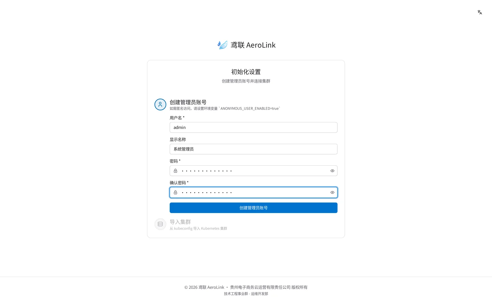

# 快速部署

目标：**先把界面跑起来，用管理员账号登录进去**。这一页只给最短路径，参数、升级、备份、换库、裸进程（systemd）等完整内容见[安装指南](./installation.md)与[部署与运维](./operations.md)。

## 一、先记住三个值

| 项 | 值 |
| --- | --- |
| 镜像 | 仓库内 chart 默认指向公司 SWR：`swr.cn-south-1.myhuaweicloud.com/gzwxh/devops/aerolink`，tag 默认取 chart 的 `appVersion`（当前 `v1.0.2`）。要自己打包见[构建并推送镜像](./build-and-push-image.md) |
| 端口 | 服务监听 `8080`。`HOST` 变量**不参与监听**，只用于生成 OAuth 回调地址 |
| 密钥 | `AEROLINK_ENCRYPT_KEY`（加密已保存的凭据）与 `JWT_SECRET`（**至少 32 字节**）。缺前者、或后者不足 32 字节，进程会**拒绝启动** |

生成两个密钥：

```bash
openssl rand -base64 32
```

::: warning 换密钥的代价
`AEROLINK_ENCRYPT_KEY` 一旦更换，此前保存的 kubeconfig、OAuth clientSecret、密码等凭据都解不开，需要重新保存。生产环境请把它固定下来并备份。
:::

## 二、方式一：Helm（推荐）

```bash
helm install aerolink charts/aerolink -n aerolink-system --create-namespace
kubectl port-forward -n aerolink-system svc/aerolink 8080:8080
```

浏览器打开 `http://localhost:8080`。

`encryptKey` 留空时 chart 会在首次安装随机生成一个，并通过 release 的 Secret 在后续升级中沿用（见 `charts/aerolink/values.yaml` 的注释），所以不改也能用；生产环境建议自管密钥后显式传入：

```bash
helm install aerolink charts/aerolink -n aerolink-system --create-namespace \
  --set encryptKey="$(openssl rand -base64 32)"
```

有域名时至少配这两项（否则访问不通、OAuth 回调地址也不对）：

```bash
helm upgrade aerolink charts/aerolink -n aerolink-system \
  --set host=https://aerolink.example.com \
  --set ingress.enabled=true --set ingress.className=nginx
```

全部参数见 [Chart Values](../config/chart-values.md)。

## 三、方式二：YAML 清单

```bash
kubectl apply -f deploy/install.yaml
```

::: warning apply 之前先改两处
`deploy/install.yaml` 里镜像是 `v1.0.0`，Secret 是 `REPLACE-ME-with-openssl-rand-base64-32-output` 占位符：把镜像换成你要部署的 tag、把 `AEROLINK_ENCRYPT_KEY` 与 `JWT_SECRET` 换成真实值再 apply。

清单还会把 `aerolink` 的 ServiceAccount 绑到 `cluster-admin`（它要管理集群资源），确认这符合你的权限口径。
:::

## 四、方式三：单机试跑（Docker）

```bash
docker run -d --name aerolink -p 8080:8080 \
  -v aerolink-data:/app/data \
  -e DB_DSN=/app/data/aerolink.db \
  -e AEROLINK_ENCRYPT_KEY="$(openssl rand -base64 32)" \
  -e JWT_SECRET="$(openssl rand -base64 32)" \
  swr.cn-south-1.myhuaweicloud.com/gzwxh/devops/aerolink:v1.0.2
```

仓库里也有 `deploy/docker-compose.yaml`：把镜像地址和密钥改好，`docker compose up -d` 即可。数据默认落在卷里，删容器不丢库。

这种方式只为先看一眼界面；要长期跑，选 Helm 或按[部署与运维](./operations.md)里的 `systemd` 方式。

## 五、第一次打开：初始化设置

库还没有管理员时，访问站点会进入「初始化设置」：

1. **创建管理员账号**：用户名、密码、显示名称（可选）。
2. **导入集群**：粘贴或上传 kubeconfig。



- 要管理的就是它自己所在的集群时，在这一步把类型切成 **In-Cluster**，用 Pod 自身的 ServiceAccount，不需要 kubeconfig。
- 完全无人值守时可以用环境变量预设：`AEROLINK_USERNAME` / `AEROLINK_PASSWORD` 建超管，`KUBECONFIG` 自动导入集群。
- 有了超管之后这个页面不会再出现。

## 六、装完至少核这五项

| 检查 | 怎么做 | 期望 |
| --- | --- | --- |
| 进程活着 | `curl -s localhost:8080/healthz` | `{"status":"ok"}` |
| 版本对得上 | `curl -s localhost:8080/api/v1/version`，或看界面侧栏 | 与部署的 tag 一致 |
| 能登录 | 用刚建的管理员账号登录 | 进入概览页 |
| 集群通了 | 左侧栏切换集群，看节点与命名空间 | 有数据 |
| 日志与终端 | 任意 Pod → 日志 / 终端 | 日志有输出，终端能连上 |

::: tip 探针用 /healthz
没有 `/readyz`、`/livez`，探针直接用 `GET /healthz`。
:::

终端、日志走 websocket：用 Ingress 暴露时记得放行 websocket（见[安装指南 → Ingress](./installation.md)）。入口是宿主机 nginx 时，务必设置 `TRUSTED_PROXIES` 写清网段，否则审计日志里的来源 IP 可被伪造。

## 七、接着做这几件事

- **建账号、发权限**：[用户管理](../config/user-management.md) → [RBAC 配置](../config/rbac-config.md)。只读的同学给「只读管理员」这类内置角色就够。
- **接指标**：[Prometheus 设置](../config/prometheus-setup.md)。
- **帮助文档入口**：另起一个文档站镜像，把地址填进「系统设置 → 通用 → 帮助文档」，登录页与顶栏就会出现入口（见[构建并推送镜像](./build-and-push-image.md)）。
- **换数据库**（SQLite → MySQL / PostgreSQL）：[数据库准备](../config/database.md)。
- **升级、回滚、备份、排障**：[部署与运维](./operations.md)。
- **参数全表**：[环境变量](../config/env.md)、[Chart Values](../config/chart-values.md)、[配置文件](../config/config-file.md)。
- **给同事的说明**：把[使用指南](/usage/)发给他们，比讲一遍快。