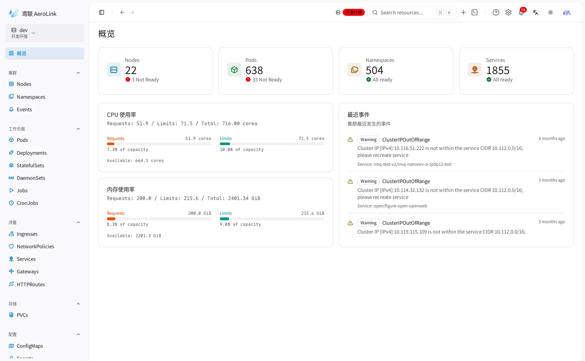

# 什么是鸢联 AeroLink？

鸢联 AeroLink 是面向平台团队的轻量、开源 Kubernetes 工作空间，将多集群运维、可观测性、访问控制和 AI 辅助排障整合到同一个界面中。

## 名称与读法

- **名称**：中文「鸢联」，英文 **AeroLink**，读作 /ˈeəroʊlɪŋk/（Aero = 天空/航空，Link = 连接）。
- **一句话定位**：飞在 K8s 之上，连通每一个集群——一线连万群，鸢飞控全局。
- **命名前缀**：环境变量统一用 `AEROLINK_`（如 `AEROLINK_ENCRYPT_KEY`），Kubernetes 注解统一用 `aerolink.io/`（如 `aerolink.io/description`）；对外域名候选为 `aerolink.io` / `aerolink.dev` / `aerolink.cloud`，内网部署域名是 `aerolink.gogdev.cn`。
- **命令行与包名**：`aero` / `alink` 与 `io.aerolink` 属命名规划，尚未提供；当前只有服务端可执行文件 `aerolink`。
- **技术声明**：本项目基于 [Kite](https://github.com/kite-org/kite) 二次开发，非 Kite 官方发行版。

## 从这里开始

:::: tip 最快体验路径
使用 Helm 安装鸢联 AeroLink，首次访问时通过端口转发打开界面，然后连接集群内的 Kubernetes API。整个初始设置不需要提前准备 kubeconfig。
::::

- 第一次打开界面、想知道哪里看日志和进容器：[使用指南](/usage/)（六步走完日常操作）
- 只想先把界面跑起来：[快速部署](./guide/quick-deploy.md)

1. [安装鸢联 AeroLink](./guide/installation.md) 并打开仪表盘。
2. 邀请团队前，先配置[用户](./config/user-management.md)和 [RBAC](./config/rbac-config.md)。
3. 需要集群指标时，再[连接 Prometheus](./config/prometheus-setup.md)。

## 文档地图

按你现在的处境挑一个：

| 区域 | 讲什么 | 适合谁 |
| --- | --- | --- |
| [安装部署](/) | 认识产品、装起来、升级回滚备份 | 第一次部署的人 |
| [使用指南](/usage/) | 六个步骤走完日常操作；按资源类型创建与修改 | 拿到账号的普通使用者 |
| [功能详解](/features/) | 每个功能的用法、限制与依赖 | 想深挖某个入口的人 |
| [管理配置](/config/) | 账号、OAuth、RBAC、安全策略、监控接入、部署参数 | 管理员 |
| [常见问题](/faq) | 按现象查原因与处理：登录、权限、日志、终端、创建 | 卡住的人 |
| [API](/api/authentication) | 接口清单与示例 | 做集成的人 |

## 常用入口

- **找资源：** [全局搜索](./features/global-search.md)、[相关资源](./features/related-resources.md)
- **排障：** [日志](./features/logs.md)、[Web 终端](./features/web-terminal.md)、[监控](./features/monitoring.md)
- **改东西：** [创建与常用操作](/usage/common-operations)、[资源历史](./features/resource-history.md)
- **装应用：** [Helm 管理](./features/helm-management.md)
- **AI 排障：** [AI 助手](./features/ai-assistant.md)
- **接私有集群：** [鸢联 AeroLink Cluster Agent](./features/aerolink-cluster-agent.md)

完整清单见[功能详解](/features/)。

## 平台能力概览

### 观察

通过实时 CPU、内存和网络图表、Pod 日志、事件与资源关系，从异常现象快速定位所需上下文。

### 运维

创建和编辑 Kubernetes 资源、管理 Helm Release、打开 Pod 与 Node 终端、运行 kubectl，并通过 Kube Proxy 访问工作负载。

### 治理

使用 OAuth、MFA、用户管理、RBAC、角色映射和审计日志，统一管理多集群中的团队访问。

## 鸢联 AeroLink 适合什么场景

Headlamp 和 Kubernetes Dashboard 都是优秀的单集群资源查看与操作工具。鸢联 AeroLink 在此基础上增加了共享的多集群工作空间、团队治理、可观测性和 AI 辅助工作流。

如果你正在评估鸢联 AeroLink，请继续阅读[安装指南](./guide/installation.md)。
