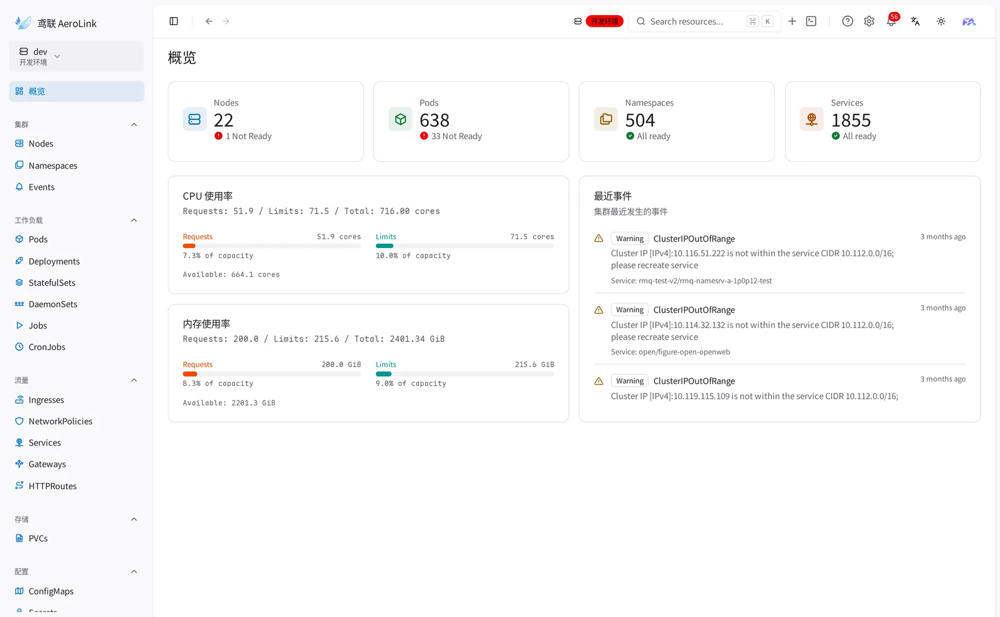

# 第 2 步：认识界面

登录后落地在首页仪表盘。整套界面只有三块需要先认清：顶栏、左侧栏、资源详情区。

## 顶栏

**左侧**（从左到右）：

- 折叠/展开侧边栏
- 前进、后退
- 面包屑：显示当前所在集群、命名空间与资源

**右侧**（从左到右）：

| 入口 | 说明 |
| --- | --- |
| 公告栏 | 管理员发布的公告，按生效时间自动出现与消失，长内容可展开读全文 |
| 当前集群 | 显示你正在操作的集群 |
| 全局搜索 | `Ctrl + K`（macOS `Cmd + K`）打开，见下文 |
| 「+」创建资源 | 有创建权限才出现 |
| Kubectl 终端 | 在网页里用 `kubectl`，有权限且管理员开启后才出现 |
| 帮助文档 | 图标存在说明管理员配了帮助文档地址 |
| 系统设置 | 管理员入口，普通账号一般不显示 |
| 站内信铃铛 | 见下文「消息与公告」 |
| 语言 | 中英文切换 |
| 主题 | 亮色 / 暗色切换 |
| 头像菜单 | 账号信息、用户信息、自定义侧边栏、退出登录 |

::: warning 入口是按权限显示的
「+」、系统设置、Kubectl 终端这类入口**没有权限就不渲染**。看不到入口要去申请权限，而不是反复刷新，详见[第 6 步：权限不够怎么办](./permissions.md)。
:::

## 左侧栏

**顶部是集群切换器**，下面是菜单分组，顺序一般是：

集群 / 工作负载 / 流量 / 存储 / 配置 / 集群基础设施 / 安全 / 证书 / 其他 / 应用

- 点分组标题展开该类的资源类型（Deployment、Pod、Service、ConfigMap……），点资源类型进列表页。
- 列表页会记住你选的命名空间，通过面包屑或列表顶部的筛选可以切换。
- 想改顺序或隐藏用不到的分组：头像菜单 →「自定义侧边栏」，详见[自定义侧边栏](../features/custom-sidebar.md)。个人布局优先，管理员发布的全局布局只影响没自己配过的账号。

::: warning 先确认当前集群
列表和操作都是**针对左侧栏选中的那个集群**。多集群环境下最常见的"这资源怎么不见了"，就是看的是另一个集群。
:::

## 全局搜索（Ctrl / ⌘ + K）

任意页面按 `Ctrl + K`（macOS `Cmd + K`）打开「全局搜索」，它可以：

- 搜索当前集群里的资源（**输入 3 个字符以上**才会开始搜）
- 当命令面板用：跳转页面、切换到某个集群、切换主题
- 打开「收藏」

用法细节见[全局搜索](../features/global-search.md)。

## 消息与公告

- **站内信**：顶栏铃铛。里面有「全部已读」「清空」等操作；订阅规则、邮件通知与公告发布由管理员在「通知管理」里配。
- **公告**：顶栏右侧滚动展示，和你的权限无关，所有人都能看到生效中的公告。

更多见[通知与公告](../features/notification-and-announcements.md)。

## 下一步

界面认清了 → [第 3 步：找到并查看资源](./resources.md)。