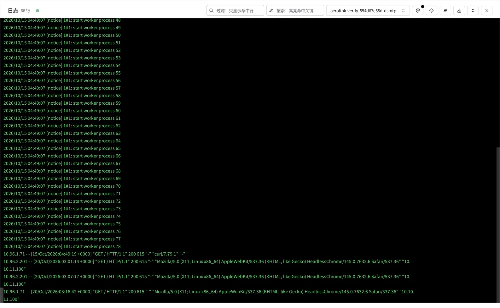
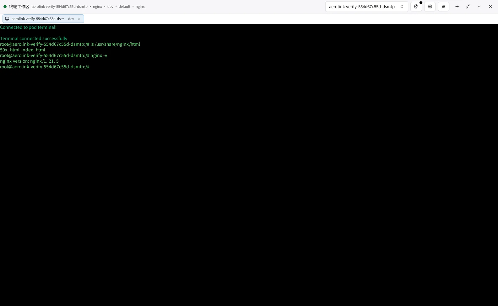

# 第 4 步：日志与容器终端

日常排障八成的动作就两个：**看日志**、**进容器**。两者都在 Pod 详情页。

## 看日志

1. 左侧栏 → 工作负载 → Pod，找到目标 Pod（用 `Ctrl + K` 全局搜索更快）；
2. 打开详情页，点页头右侧的「日志」按钮——日志在页面底部的终端工作区打开，不会离开当前页；
3. 一个 Pod 多个容器时，先在工作区左上角选对容器；
4. 用过滤框筛关键字，需要时再开搜索高亮与自动滚动。

| 编号 | 位置 | 说明 |
| --- | --- | --- |
| ① | 页头按钮 | 点「日志」在页面底部打开日志工作区 |
| ② | 工作区左上 | 日志标签，显示当前是哪份日志；工作区可拖动、最大化 |
| ③ | 工具栏 | 过滤框：输入后只显示命中的行 |
| ④ | 工具栏右侧 | 搜索高亮、主题、换行、下载、全屏 |

多容器 Pod 还要先选容器，下图里日志页签顶部就是容器切换区：

「上一个容器日志」（容器重启前的日志）在同一页签里可以切换，用来排查"起来就崩"的容器。

需要把日志拿走去分析时，点日志工具栏右侧的下载图标，会保存当前视图为 `.txt`。完整说明见[下载与上传](./downloads.md#下载日志)和[日志](../features/logs.md)。

## 进容器终端

1. 在 Pod 详情页点页头的「终端」按钮；
2. 终端会**在页面底部的终端工作区打开**（不是弹窗，切页签不会丢会话）；
3. 想开第二个终端，再点一次即可并排使用。

注意：

- 终端需要 Pod 的 `exec` 权限，没有权限时页签点了不会给你会话。
- 终端会话是**有超时的**，长时间挂着的会话可能被回收，需要重连。
- 容器里没有 `bash` 时改用 `sh`。

完整说明见 [Web 终端](../features/web-terminal.md)。

## 浏览容器文件

Pod 详情页的「文件」页签可以浏览容器内目录，预览、下载/上传文件；目录行点下载会打包成 `.tar`。下载与上传需要管理员**单独授权**「容器文件」相关权限，只读浏览也是权限判定的一部分——看不到就找管理员开。

分步说明与截图见[下载与上传 · 下载容器里的文件](./downloads.md#下载容器里的文件)。

## Pod 起不来怎么查 {#pod-not-starting}

按这个顺序看，基本能定位到原因：

| 顺序 | 看什么 | 能看出什么 |
| --- | --- | --- |
| 1 | 列表里的状态与 Pod 状态图标 | Pending / CrashLoopBackOff / ImagePullBackOff 等 |
| 2 | 详情页「事件」页签 | 调度失败、拉镜像失败、探针失败的具体原因 |
| 3 | 行操作「描述」 | kubectl describe 的完整输出，含 Conditions、Events |
| 4 | 「日志」页签的"上一个容器日志" | 进程启动即退出的报错 |
| 5 | 「YAML」页签 | 镜像 tag、资源限制、挂载、探针配置是否写错 |
| 6 | 行操作「调试」 | 起临时容器进同一网络/进程命名空间排查，或复制一个 Pod 改配置试 |

镜像拉取失败时顺手在「相关资源」里确认 imagePullSecret 与镜像地址是否正确。

## 日志或终端连不上时

- 页面能打开、日志却是空的：先确认容器选对了、Pod 在 Running、日志确实输出到 stdout/stderr。
- 日志能看、终端连不上：终端走 websocket，通常是被 Ingress / 反向代理挡住了 —— 这类问题找管理员（对应[安装指南](../guide/installation.md)里的 websocket 与代理配置）。
- 多个副本只想看某一个：直接进具体 Pod 的日志页签，不要用工作负载级别的聚合视图。

## 下一步

需要动手建东西、改东西 → [第 5 步：创建与常用操作](./common-operations.md)。