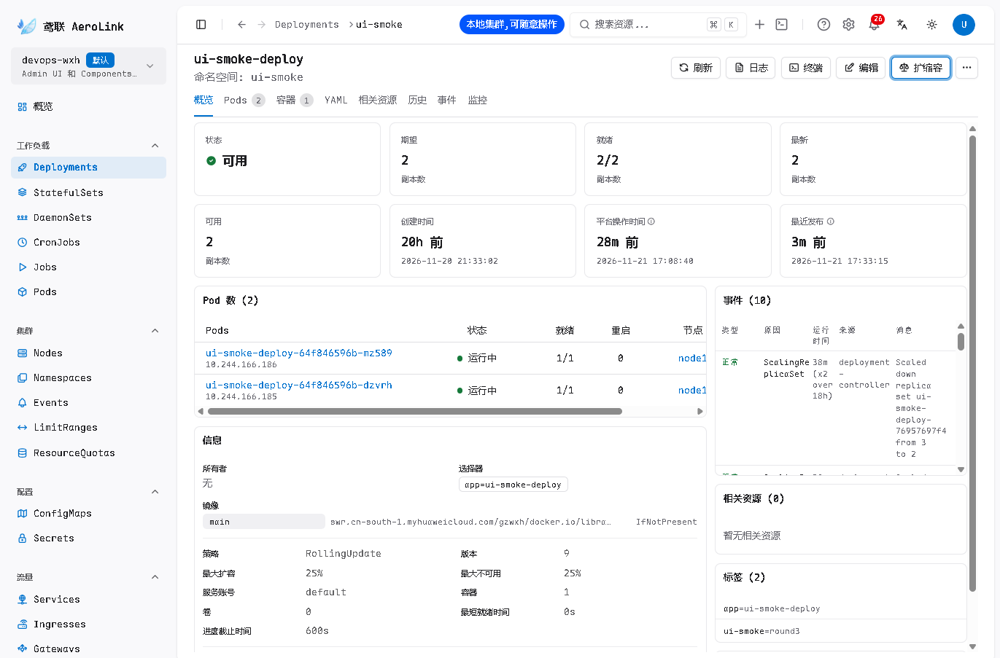

# 第 3 步：找到并查看资源

## 三种找法

| 场景                         | 用哪种                                                              |
| ---------------------------- | ------------------------------------------------------------------- |
| 知道看哪一类                 | 左侧栏 → 对应分组 → 资源类型                                        |
| 只知道名字（或名字的一部分） | `Ctrl + K` 全局搜索，输入 3 个字符以上                              |
| 从上下游对象找               | 详情页「相关资源」页签（Deployment → 它的 Pod，Service → 后端 Pod） |

## 列表页

打开某个资源类型后是一个列表页，通用能力：

- **命名空间范围**：列表顶部可以切换命名空间（默认按你上次的选择），多命名空间时先确认范围对不对。
- **搜索框**：占位符是「搜索资源名称...」，按名称过滤当前列表。
- **行操作**：每行末尾的操作菜单，是"查看 YAML / 编辑 YAML / 日志 / 终端 / 扩缩容 / 删除"这些动作的入口 —— 具体有哪些，取决于你的权限和资源类型。
- **批量操作**：勾选多行后可以对选中项批量执行同一种动作；删除会先列出要删的对象、要求输入数量确认，执行失败的对象逐条列出（已成功的不回滚）。
- **刷新**：数据不是实时的，手动「刷新」或页面自带的自动刷新可以拿到最新状态。
- **下载列表数据**：工具栏右侧的「下载」按钮可以把当前列表导成 CSV 或 JSON，见下节。

### 下载列表数据

「下载 ⌄」菜单先选范围、再选格式：

| 范围     | 导出哪些行                                      |
| -------- | ----------------------------------------------- |
| 当前所选 | 只导出勾选的行（没有勾选时置灰）                |
| 全部     | 当前搜索 / 列筛选后的全部行，翻页不影响导出范围 |

| 格式 | 内容                                                                       |
| ---- | -------------------------------------------------------------------------- |
| CSV  | 表格当前展示的各列，一行一条；带 UTF-8 BOM，Excel / WPS 双击打开中文不乱码 |
| JSON | 同一份表格数据，按列标题转成对象数组                                       |

导出内容跟着表格的显示走：

- 列的范围等于**当前可见列** —— 用表头右侧的「显示列」开关调，隐藏的列不会出现在文件里；
- 按命名空间分组的列表（Deployments、StatefulSets、DaemonSets）即使命名空间列被隐藏，导出也会自动带上「命名空间」列；
- 这三个列表还会额外带一列「权限绑定」，值是命名空间所属的权限绑定组（与命名空间页的「项目 / 权限绑定」同源，未绑定时为空）；
- 镜像、CPU / 内存、标签、注解这些列导出的是可读文本（如镜像只留镜像地址），不会把整个对象结构塞进单元格。

目前 Nodes、Deployments、StatefulSets、DaemonSets 四个列表提供该按钮。

::: tip 和行操作里的「下载 YAML」有什么区别
行操作菜单的「下载 YAML」导出单个对象的完整清单，可以拿去 `kubectl apply -f`；「下载」按钮面向表格数据，用于交给 Excel 或脚本处理，JSON 里同样只有表格展示的字段，不是完整清单。
:::

## 详情页看什么

点资源名进详情页，页签按资源类型略有不同，常见的几类：

| 页签               | 用途                                                                                |
| ------------------ | ----------------------------------------------------------------------------------- |
| 概览               | 状态、副本数、镜像、标签注解等最关键的信息                                          |
| YAML               | 完整定义（只读查看，有权限可以直接编辑）                                            |
| 事件               | 调度、拉镜像、探针失败等具体原因，排障第一现场                                      |
| 相关资源           | 上下游对象，快速在对象之间跳转                                                      |
| 监控               | CPU / 内存曲线（管理员接了 Prometheus 才有数据）                                    |
| 历史               | 工作负载的版本变化，可对比差异并回滚，见[资源历史](../features/resource-history.md) |
| 日志 / 终端 / 文件 | 只在 Pod 上有，见[第 4 步](./logs-terminal.md)                                      |

## 看不到资源？

按这个顺序怀疑：

1. **集群选错了**：左侧栏顶部的集群切换器显示的是当前集群，多集群环境最常见。
2. **命名空间选错了**：换成「全部命名空间」或目标命名空间再看。
3. **资源确实不存在**：比如 Deployment 还没创建出来，或被删掉了；要建新的看[创建资源](./common-operations.md#创建资源)。
4. **没有权限**：没权限的资源不会出现在列表里，也不会明确告诉你"存在但你看不到"。确认方式是把资源名发给管理员，让他查你是否有该命名空间的读权限，见[第 6 步](./permissions.md)。

::: tip 列表空 ≠ 报错
没有读权限时列表就是空的，不会有 403 弹窗 —— 这是有意为之，避免泄露资源是否存在。
:::

## 下一步

找到资源了 → [第 4 步：日志与容器终端](./logs-terminal.md)。
